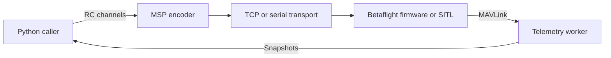

# Betaflight client examples

Examples for exploring Betaflight SITL, MAVLink telemetry and simulated flight.

## Overview

This Python project helps developers explore Betaflight software-in-the-loop (SITL), inspect MAVLink telemetry over TCP or serial, and experiment with simulated flight. The flight examples are experimental and intended for simulation only.

## Features

- MAVLink heartbeat, message monitoring, and rate measurement examples.
- MSP RC frame encoding and sending over TCP or serial.
- Threaded MAVLink telemetry with immutable snapshots and acknowledged stream-rate requests.
- VS Code tasks for SITL setup and experimental Bullet flight integration.

## Architecture

`src/beta_client/msp.py` encodes and sends RC frames through the transport interface. `transport.py` owns TCP and serial connections. `mavlink.py` receives telemetry on a worker thread and exposes snapshots to callers. The examples compose these pieces with Betaflight SITL and, for flight simulations, the separate `bullet_drone` project.



## Requirements

- Python 3.12 or newer and [uv](https://docs.astral.sh/uv/getting-started/installation/).
- `pymavlink>=2.4.50` and `pyserial>=3.5`, installed by `uv sync`.
- A MAVLink-enabled Betaflight build and configured UART for telemetry examples.
- For flight simulation, a local `bullet_drone` checkout and compatible sensor-only SITL build.
- For hardware telemetry, a serial adapter and device permissions appropriate to your system.

The bundled SITL tasks use Linux shell tools. A supported operating-system matrix is unspecified.

## Installation

From the repository root:

```sh
uv sync
```

This creates or updates the `.venv` environment using `pyproject.toml` and `uv.lock`, including `pymavlink` and `pyserial`. For the flight examples, also install the `flight` extra:

```sh
uv sync --extra flight
```

This installs `bullet_drone` and its dependencies. The flight extra points to `/home/user/workspaces/bullet/bullet_drone` in `pyproject.toml`; change that path if your Bullet checkout is elsewhere. To keep the extra when running a command through `uv run`, include `--extra flight` in that command as well. The MSP flight task uses this project’s `flight` extra. The pure-MAVLink flight task still uses the separate Bullet workspace environment.

After changing dependencies, run `uv sync` again to update the lockfile and environment. Use `uv sync --locked` when you want synchronization to fail if `uv.lock` needs updating.

## Quick Start

For the bundled SITL, use **Terminal → Run Task** in VS Code:

1. Stop any running SITL instance and run `SITL: Configure MAVLink UART2`.
2. Run `SITL: Run`.
3. In a separate terminal, run:

```sh
uv run python examples/mavlink_heartbeat.py tcp:127.0.0.1:5762
```

Expected output is `Heartbeat from system <id>, component <id>`. If no heartbeat arrives within 10 seconds, the example exits with a configuration error.

## Usage

### Examples

| Example | Summary |
| --- | --- |
| [MAVLink heartbeat](examples/mavlink_heartbeat.py) | Connect to a MAVLink TCP endpoint and print the first heartbeat. |
| [MAVLink rates](examples/mavlink_rates.py) | Request attitude and VFR HUD messages at 50 Hz and measure their received rates over TCP or serial. |
| [USB MAVLink monitor](examples/mavlink_usb_monitor.py) | Print MAVLink messages and per-type rates from a serial adapter. |
| [USB MAVLink rates](examples/mavlink_usb_rates.py) | Measure attitude and VFR HUD rates through a serial adapter. |
| [MSP and MAVLink flight](examples/msp_mavlink_flight/README.md) | Experimental simulation: send RC commands over MSP and read telemetry over MAVLink. Requires the separate `bullet_drone` project. |
| [MAVLink flight](examples/mavlink_flight/README.md) | Standalone pure-MAVLink flight experiment; **not working**, pending investigation of MAVLink RC receiver support and configuration. |

### VS Code tasks

Run these using **Terminal → Run Task**.

| Task | Function |
| --- | --- |
| `SITL: Configure MAVLink UART2` | Saves the MAVLink telemetry configuration in the `.sitl` working directory. Stop SITL before running it. |
| `SITL: Run` | Starts the bundled SITL using the saved `.sitl` configuration. |
| `MAVLink: Read heartbeat` | Connects to an already running SITL on port 5762 and prints a heartbeat. |
| `SITL: Run and choose MAVLink example` | Starts SITL, then runs the selected heartbeat or message-rate example. Configure UART2 first. |
| `Bullet: SITL MAVLink flight` | Starts the standalone MAVLink flight experiment and its SITL. **Not working** with the bundled firmware. |
| `Bullet: SITL MSP MAVLink flight` | Starts the MSP control and MAVLink telemetry flight example and its SITL. |

The MSP flight task requires the `bullet_drone` path configured in `pyproject.toml`. The pure-MAVLink flight task uses `/home/user/workspaces/bullet`; update its command if the workspace is installed elsewhere.

### MSP RC client

Build and send eight RC channels in the receiver's configured order over TCP:

```python
from beta_client.entities import RcChannels
from beta_client.msp import send_rc
from beta_client.transport import TcpTransport

with TcpTransport('127.0.0.1', 5761) as transport:
    send_rc(transport, RcChannels((1500, 1500, 1000, 1500, 1000, 2000, 1000, 1000)))
    transport.drain_responses()  # Discard replies in a send-only RC loop.
```

For serial, use `SerialTransport('/dev/ttyUSB0', 115200)` in the same way, with the device and baud rate configured for your receiver. Use `build_rc_message(channels)` when you need the encoded frame separately.

The caller owns the connection and must send values continuously at a rate appropriate for the receiver and its failsafe. A single frame does not provide sustained control. Test in simulation first.

TCP and serial writes block with a default 20 ms timeout, matching one 50 Hz control period. Override `timeout` to fit your loop budget; TCP connection establishment has a separate `connect_timeout` default of 3 seconds. Serial partial writes share one timeout budget. These are host-side write budgets, not guaranteed delivery or real-time deadlines.

Call `drain_responses()` each cycle in a send-only loop to discard buffered replies without waiting. Each call discards at most 4096 bytes to bound receive work. Omit draining if you need to parse replies instead. Transports are intended for a single caller; do not read or write them concurrently.

### Threaded MAVLink telemetry

`MavlinkTelemetry` receives on its own thread; callers read frozen snapshots without connection I/O:

```python
from beta_client.mavlink import MavlinkTelemetry
from pymavlink import mavutil

with MavlinkTelemetry('tcp:127.0.0.1:5762') as telemetry:
    telemetry.set_message_rate(mavutil.mavlink.MAVLINK_MSG_ID_VFR_HUD, rate_hz=50)
    sample = telemetry.snapshot()
    print((sample.vfr_hud.alt if sample.vfr_hud else None), sample.vfr_hud_at, bool(sample.heartbeat.base_mode & mavutil.mavlink.MAV_MODE_FLAG_SAFETY_ARMED))
```

For serial, pass a device endpoint such as `/dev/ttyUSB0` and `baud=57600`. Context entry waits only for a vehicle heartbeat. Call `set_message_rate(message_id, rate_hz, timeout=5.0)` to request each desired stream. It blocks until the selected vehicle acknowledges acceptance, raises `RuntimeError` on rejection, and raises `TimeoutError` if no final acknowledgement arrives. Only finite positive rates are supported; actual delivery rates may differ. Concurrent requests are serialized, with the ACK timeout starting when the worker sends the command. A timeout fails and closes the link, preventing a late acknowledgement from being attributed to another request. Snapshot fields can be `None` until received; timestamps use local monotonic time. Consumers must check freshness and validity before control. Worker failures raise from `snapshot()` with the original cause; reconnection is not automatic. The worker owns the connection and closes it on exit. Protocol waits are bounded, but initial connection opening is subject to pymavlink and operating-system behavior.

See the [flight control flow](examples/msp_mavlink_flight/README.md#threaded-telemetry-and-altitude-control) for how altitude drives MSP throttle commands.

Shared immutable payload entities live in `beta_client.entities`: `Heartbeat`, `Attitude`, `VfrHud`, `CommandLong`, `CommandAck`, and `RcChannelsOverride`. Their docstrings link to MAVLink definitions and describe field units. Snapshots group `heartbeat`, `attitude`, and `vfr_hud` payloads with local monotonic reception timestamps. RC senders use the shared `RcChannels` value entity. This replaces the previous flat telemetry and list-based RC interfaces.


## Configuration

The telemetry examples require a firmware build with MAVLink telemetry enabled and a UART assigned to MAVLink. For the included SITL binary, [config/sitl-mavlink.txt](config/sitl-mavlink.txt) enables telemetry and assigns MAVLink telemetry to UART2 (TCP port 5762). UART1 is typically used for MSP on TCP port 5761. SITL saves settings in its working directory, so configure the instance you intend to run.

The MSP flight example uses its own [SITL configuration](examples/msp_mavlink_flight/sitl.config): MSP receiver input, AETR channel order, AUX1 for arming and AUX2 for angle mode. Its Bullet integration requires a compatible sensor-only SITL build. Both flight examples are experimental and intended for simulation only.

MAVLink telemetry support alone does not establish that MAVLink RC commands are supported or configured. The bundled binary rejects the receiver setting used by the pure-MAVLink example; that integration needs further investigation.

## Project Structure

```text
.
├── src/beta_client/   # MSP, transports, and threaded MAVLink telemetry
├── tests/            # unittest tests
├── examples/         # Telemetry tools and flight experiments
├── config/           # SITL MAVLink configuration
├── docs/             # Betaflight build and protocol guides
├── bin/              # Bundled SITL binary
├── .vscode/          # SITL and example tasks
├── pyproject.toml    # Package metadata and dependencies
├── uv.lock           # Locked dependencies
└── README.md
```

## Development

Use `uv sync` to prepare the development environment. The package uses the `uv_build` backend; build a distribution with:

```sh
uv build
```

Follow the Python guidelines in [AGENTS.md](AGENTS.md). Formatter and static-analysis commands are unspecified. Use the [VS Code tasks](#vs-code-tasks) to run SITL and examples, and consult the [firmware build guide](docs/build-betaflight-mavlink.md) for Betaflight builds. A debugger launch configuration is not provided.

## Testing

Run the standard-library unittest suite:

```sh
uv run python -m unittest discover -s tests
```

The suite covers MSP frames, transport behavior, threaded MAVLink telemetry, and flight RC behavior. Passing these tests does not verify firmware compatibility or simulated flight.

## Documentation

- [Build SITL with MAVLink telemetry and configure UART2](docs/build-betaflight-mavlink.md#build-sitl-locally)
- [Build and flash hardware firmware with MAVLink telemetry](docs/build-betaflight-mavlink.md#build-and-flash-hardware-firmware)
- [Betaflight and MAVLink messages and configuration](docs/betaflight-mavlink.md)
- [Betaflight MSP and SITL](docs/betaflight-msp.md)
- [MSP and MAVLink flight experiment](examples/msp_mavlink_flight/README.md)
- [Pure-MAVLink flight experiment](examples/mavlink_flight/README.md)

## Troubleshooting

### No heartbeat

Check that SITL is running, MAVLink telemetry is enabled, and UART2 uses TCP port 5762. Stop SITL before configuring it, and use the same `.sitl` working directory when configuring and running.

### Flight dependency cannot be found

Update the local `bullet_drone` path in `pyproject.toml`, then run `uv sync --extra flight`. The pure-MAVLink task separately references `/home/user/workspaces/bullet` in `.vscode/tasks.json`.

### Pure-MAVLink flight fails to configure

The bundled binary rejects `serialrx_provider = MAVLINK`. The example is not working and requires further investigation of receiver support and configuration.

### MSP flight validation status is unclear

The MSP flight README contains both unverified-integration notes and a claim of a tested simulated flight. Its end-to-end validation status is unresolved; the included binary is documented as unpatched, while Bullet requires the sensor-only patch.

### Telemetry request times out

A stream-rate acknowledgement timeout fails and closes the telemetry link. Check firmware support and the endpoint before creating a new connection. Inspect the original cause when `snapshot()` reports a worker failure.

## Roadmap

A project roadmap is unspecified.

## Contributing

A contribution process is unspecified. Follow [AGENTS.md](AGENTS.md) for Python changes and run the tests before proposing a change.

## License

A project license is unspecified; no root license file is provided.
