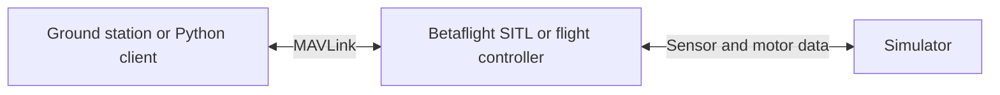

# Betaflight and MAVLink

MAVLink is a message protocol that can carry telemetry, receiver input and commands. Betaflight supports only a subset, depending on its version and build. It is not a complete replacement for MSP.



## Version and build support

MAVLink telemetry predates Betaflight 2025.12, though the exact first release has not been verified here. The MAVLink serial receiver was introduced in 2025.12. Betaflight 2026.6 expanded telemetry for QGroundControl, including message-rate configuration and mission transfer. Features depend on build flags and target hardware. See [build options](https://betaflight.com/docs/wiki/guides/current/Build-Options) and [2026.6 release notes](https://betaflight.com/docs/wiki/release/Betaflight-2026-6-Release-Notes).

## SITL

SITL runs Betaflight on a computer and can expose simulated UARTs over TCP. Its usual TCP port 5761 is documented as the **MSP** UART; it is not automatically a MAVLink endpoint. A MAVLink-enabled build and a UART configured for MAVLink are required. A direct TCP connection has no physical baud rate to match. For the included build, configure UART2 using the setup task described in the [build guide](build-betaflight-mavlink.md), then connect to TCP port 5762. See the [SITL setup](https://github.com/betaflight/betaflight/blob/2026.6.2/.devcontainer/README.md) and [serial configuration documentation](https://betaflight.com/docs/wiki/guides/current/Serial).

## Messages and commands

The tables describe the tagged Betaflight **2026.6.2** implementation, not every message defined by MAVLink. Telemetry, MAVLink receiver and mission support require the relevant build features and configuration. Sensor-dependent messages may not contain useful readings without the corresponding sensors. See the tagged [telemetry](https://github.com/betaflight/betaflight/blob/2026.6.2/src/main/telemetry/mavlink.c), [receiver](https://github.com/betaflight/betaflight/blob/2026.6.2/src/main/rx/mavlink.c), and [mission](https://github.com/betaflight/betaflight/blob/2026.6.2/src/main/telemetry/mavlink_mission.c) sources.

### Incoming messages

| Message | Description |
| --- | --- |
| `HEARTBEAT` | Identifies a connected MAVLink system. |
| `PING` | Requests a connection response. |
| `TIMESYNC` | Exchanges time synchronization data. |
| `COMMAND_LONG` | Carries a supported command and its parameters. |
| `RC_CHANNELS_OVERRIDE` | Supplies RC channel values through the MAVLink receiver. |
| `RADIO_STATUS` | Supplies radio link status to the MAVLink receiver. |
| `MISSION_REQUEST_LIST` | Requests the mission list. |
| `MISSION_REQUEST_INT` | Requests a mission item. |
| `MISSION_COUNT` | Starts a mission upload with an item count. |
| `MISSION_ITEM_INT` | Supplies a mission item. |
| `MISSION_CLEAR_ALL` | Requests mission removal. |
| `MISSION_SET_CURRENT` | Requests a current mission item change. |
| `MISSION_ACK` | Acknowledges a mission transfer. |

The mission messages require mission support. An incoming message or command may be rejected depending on its parameters and flight-controller state.

`COMMAND_LONG` handles these commands:

| Command | Description |
| --- | --- |
| `MAV_CMD_REQUEST_AUTOPILOT_CAPABILITIES` | Requests autopilot version and capability information. |
| `MAV_CMD_REQUEST_MESSAGE` | Requests one of the supported information messages. |
| `MAV_CMD_SET_MESSAGE_INTERVAL` | Sets, resets, or disables a supported message's update interval. |

Mission items also carry `MAV_CMD` values, but these are separate from `COMMAND_LONG` support. Consult the mission source for supported mission item types and restrictions.

### Outgoing messages

| Message | Description |
| --- | --- |
| `HEARTBEAT` | Reports controller identity, mode and status. |
| `SYS_STATUS` | Reports system and sensor status. |
| `SYSTEM_TIME` | Reports system time. |
| `ATTITUDE` | Reports orientation and angular rates. |
| `BATTERY_STATUS` | Reports battery information. |
| `GPS_RAW_INT` | Reports GPS measurements. |
| `GLOBAL_POSITION_INT` | Reports estimated global position. |
| `GPS_GLOBAL_ORIGIN` | Reports the global origin. |
| `HOME_POSITION` | Reports the home position. |
| `RC_CHANNELS_RAW` | Reports RC channel values. |
| `VFR_HUD` | Reports flight data such as heading and altitude. |
| `STATUSTEXT` | Reports a human-readable status message. |
| `PING` | Responds to a ping. |
| `TIMESYNC` | Responds to a time synchronization message. |
| `COMMAND_ACK` | Reports a command's result. |
| `AUTOPILOT_VERSION` | Reports firmware version and capabilities. |
| `PROTOCOL_VERSION` | Reports supported MAVLink protocol versions. |
| `COMPONENT_INFORMATION` | Reports component information. |
| `AVAILABLE_MODES` | Describes an available flight mode. |
| `AVAILABLE_MODES_MONITOR` | Reports changes to available modes. |
| `MESSAGE_INTERVAL` | Reports a message's update interval. |
| `MISSION_ACK` | Reports a mission operation's result. |
| `MISSION_COUNT` | Reports the number of mission items. |
| `MISSION_REQUEST_INT` | Requests a mission item during upload. |
| `MISSION_ITEM_INT` | Sends a mission item during download. |
| `MISSION_CURRENT` | Reports the current mission item. |
| `MISSION_ITEM_REACHED` | Reports that a mission item was reached. |

Test control functionality in simulation first, and remove propellers when testing on hardware.

### Python heartbeat example

With SITL built with MAVLink telemetry and a simulated UART configured for MAVLink, run:

```bash
uv run --with pymavlink python examples/mavlink_heartbeat.py tcp:127.0.0.1:5762
```

Replace the endpoint with the configured MAVLink UART's TCP address. The included SITL binary contains MAVLink telemetry. See the [build guide](build-betaflight-mavlink.md) for build instructions and configuration limitations. The script waits up to ten seconds for a heartbeat; a reachable TCP port alone does not mean MAVLink is enabled.


### Read rates from hardware over USB serial

Connect a USB-to-serial adapter to a flight-controller UART configured for MAVLink telemetry. Connect adapter RX to FC TX, adapter TX to FC RX, and ground to ground. The FC's USB VCP normally carries MSP and will not necessarily output MAVLink. Close other programs using the serial device. Remove propellers before working on the flight controller.

```bash
uv run --with pymavlink --with pyserial python examples/mavlink_usb_rates.py
```

The default is `/dev/ttyUSB0` at 57600 baud. Supply a different device and `--baud` if needed. The example waits for a heartbeat, requests `ATTITUDE` and `VFR_HUD` at 50 Hz, checks acknowledgements, and prints measured rates once per second for 60 seconds. It does not arm or send RC commands. No heartbeat can mean MAVLink is unavailable, assigned to another port, or using a different baud rate.
