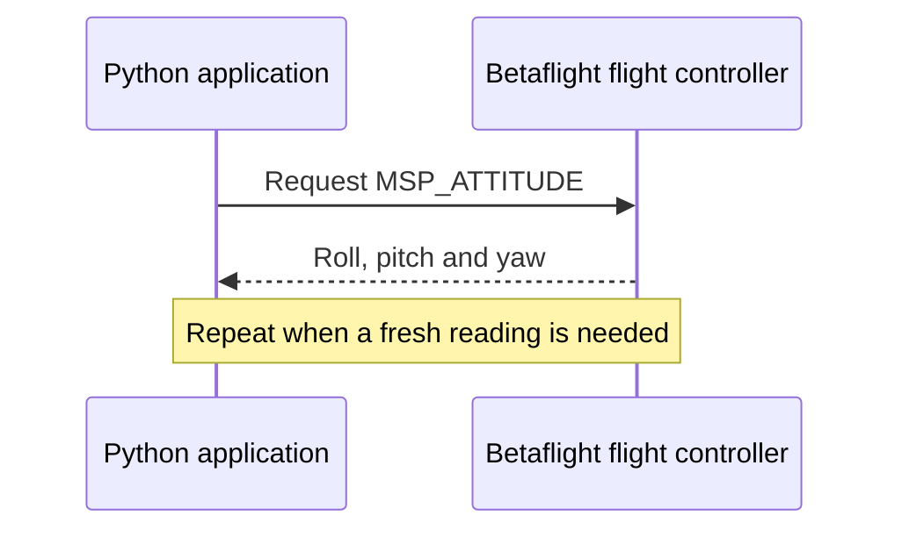
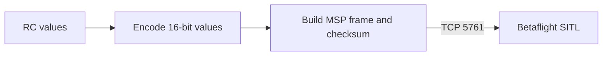
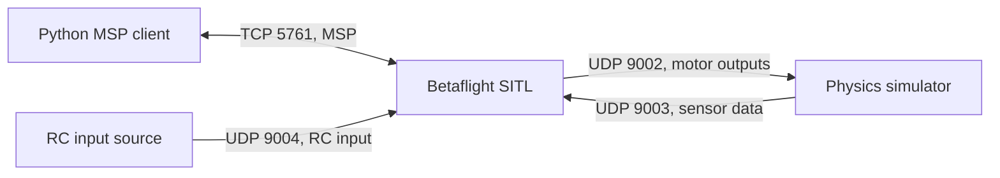

# Betaflight MSP and SITL

## The basic idea

MSP (MultiWii Serial Protocol) lets an application exchange binary messages with a flight controller. A Python program can ask Betaflight for its attitude, for example, and decode the reply. MSP also supports configuration and control commands. The protocol describes the messages; a serial port or TCP connection carries them.



In practice, connect to an MSP-enabled port, send a correctly framed request, validate the response and decode its payload. MSP has different protocol versions and payloads can vary with firmware version; consult the [Betaflight MSP reference](https://betaflight.com/docs/development/MSP-Protocol-Reference-Dev) for the exact format. This project does not yet implement an MSP client.

## Common commands

| Command | Direction | Purpose |
| --- | --- | --- |
| `MSP_RC` | Read from controller | Read RC channel values. |
| `MSP_SET_RAW_RC` | Send to controller | Provide RC channel values when configured to accept MSP receiver input. |
| `MSP_ATTITUDE` | Read from controller | Read roll, pitch and yaw. |
| `MSP_STATUS` | Read from controller | Read controller status, including sensor and mode information. |
| `MSP_ALTITUDE` | Read from controller | Read estimated altitude and vertical speed. |

These are protocol messages, not Python methods. Sensor availability, configuration and firmware version affect the data and behavior. Sending RC values is not the same as directly commanding motor outputs. Test control commands in simulation first; on real hardware remove propellers and understand the receiver and failsafe configuration.

## Example: send RC values to SITL

`MSP_SET_RAW_RC` sends channel values in the configured order. This example assumes default AETR: roll, pitch, throttle, yaw, then auxiliary channels. Sticks are centered and throttle is low. Check your channel mapping and auxiliary functions before use.



Configure SITL to accept MSP receiver input first. One frame demonstrates the message, not continuous control. Real control needs a steady stream and tested failsafe; see the [Betaflight companion-control guide](https://betaflight.com/docs/wiki/guides/current/MSP-Companion-Computer-Control). Test in simulation first and remove propellers when testing hardware.

<details>
<summary>Show Python example</summary>

```python
import socket
import struct

# Default AETR: roll, pitch, throttle, yaw, then AUX1–AUX4.
channels = (1500, 1500, 1000, 1500, 1000, 1000, 1000, 1000)
payload = struct.pack("<8H", *channels)  # Little-endian 16-bit values.
body = bytes([len(payload), 200]) + payload  # Command 200: MSP_SET_RAW_RC.
checksum = 0
for byte in body:
    checksum ^= byte
frame = b"$M<" + body + bytes([checksum])  # MSP v1 request.

# SITL exposes its simulated MSP UART over TCP.
with socket.create_connection(("127.0.0.1", 5761), timeout=2) as connection:
    connection.sendall(frame)
```

</details>

## SITL and connections

Software-in-the-loop (SITL) runs Betaflight firmware on a computer. A simulator supplies simulated sensor data and receives motor outputs, while a client can use MSP to inspect the flight controller.



The [Betaflight SITL example](https://github.com/betaflight/betaflight/blob/master/.devcontainer/README.md) exposes simulated UART1 as an MSP TCP proxy on `127.0.0.1:5761`. Connect a TCP socket there and exchange MSP frames. The UDP RC input shown above is a separate SITL interface, not an MSP message. Ports and setup can vary with the firmware and simulator configuration.

### Baud rate

A direct TCP connection has no physical serial baud rate to match: connect to the host and TCP port rather than configuring a baud rate on the socket. A separate TCP-to-serial bridge may expose a virtual serial device and have its own settings; consult that bridge's documentation.

For a real UART, enable MSP on the intended port in Betaflight Configurator's **Ports** tab, select its MSP baud rate, and set the same baud rate in the Python serial client. Avoid assigning conflicting functions to the same UART. USB virtual serial ports and adapters can behave differently from physical UARTs; follow the device's connection guidance. See the [Ports tab documentation](https://betaflight.com/docs/wiki/app/ports-tab).

## Is MAVLink an alternative?

Betaflight supports MAVLink telemetry in suitable firmware builds, and also has a MAVLink receiver protocol. MAVLink can be useful for supported ground-station telemetry, but do not assume it exposes every MSP configuration or control function. Available features depend on the Betaflight version and build. See [Betaflight build options](https://betaflight.com/docs/wiki/guides/current/Build-Options) and its [MAVLink telemetry guide](https://betaflight.com/docs/wiki/guides/current/MAVLinkELRS).
