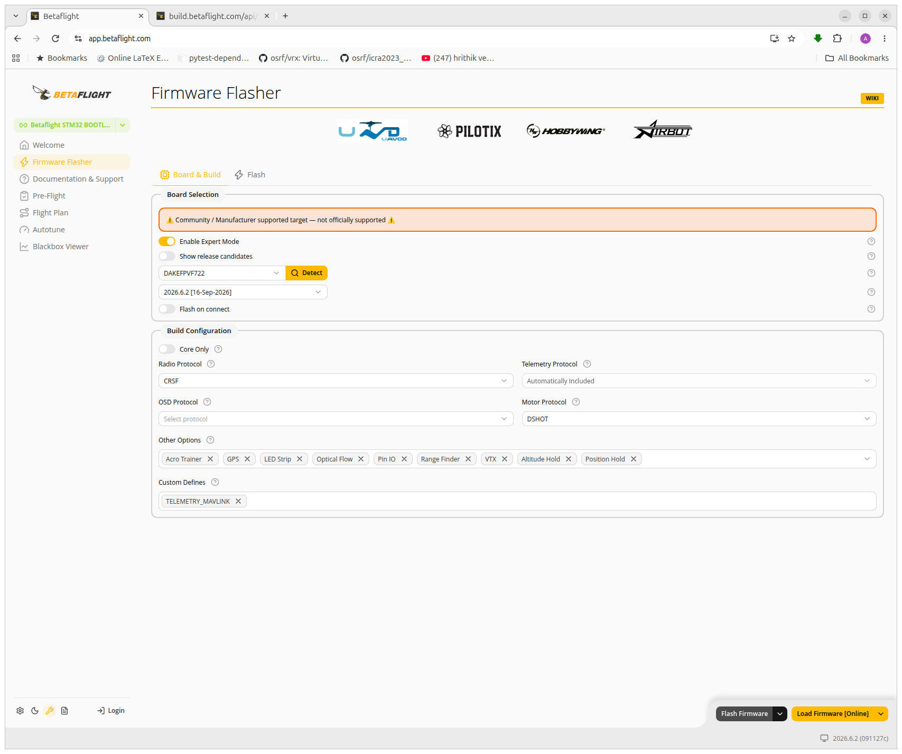
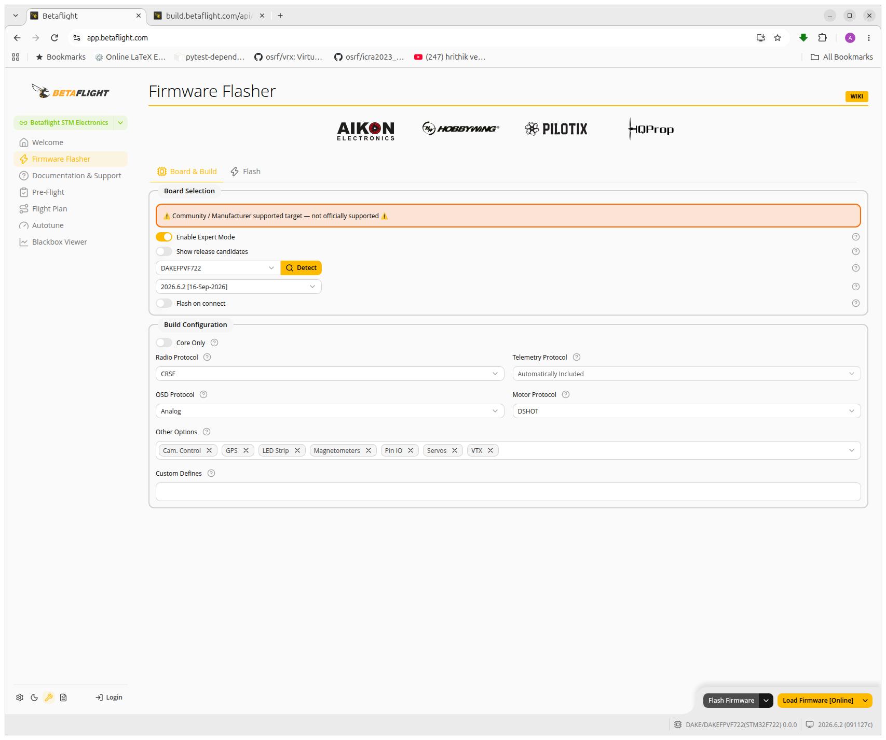
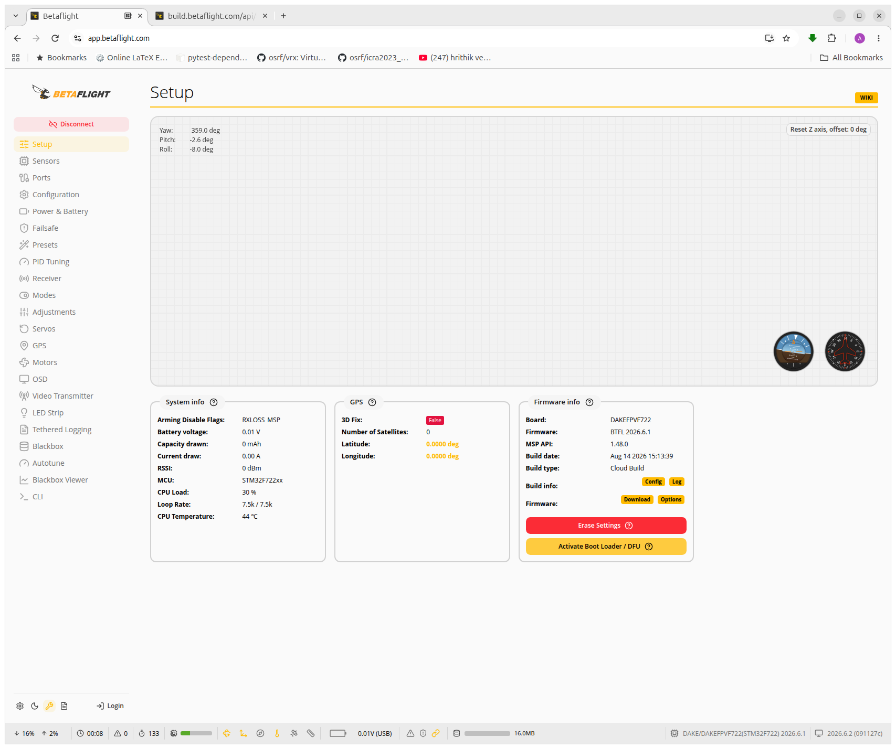
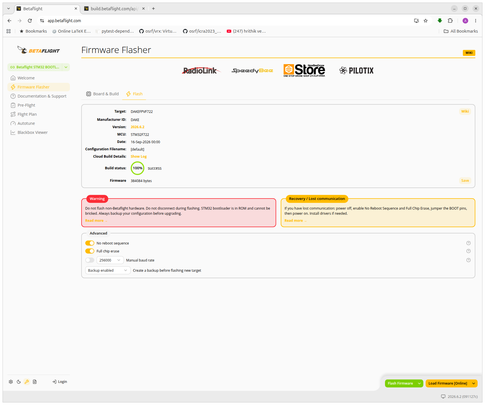
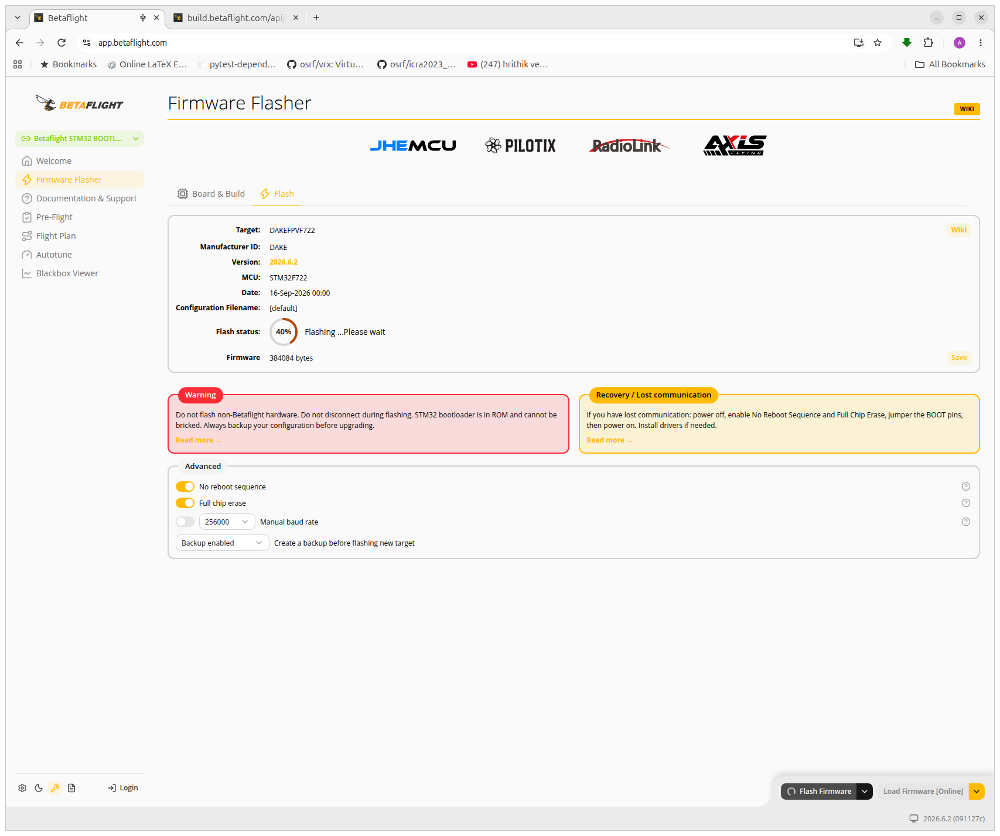
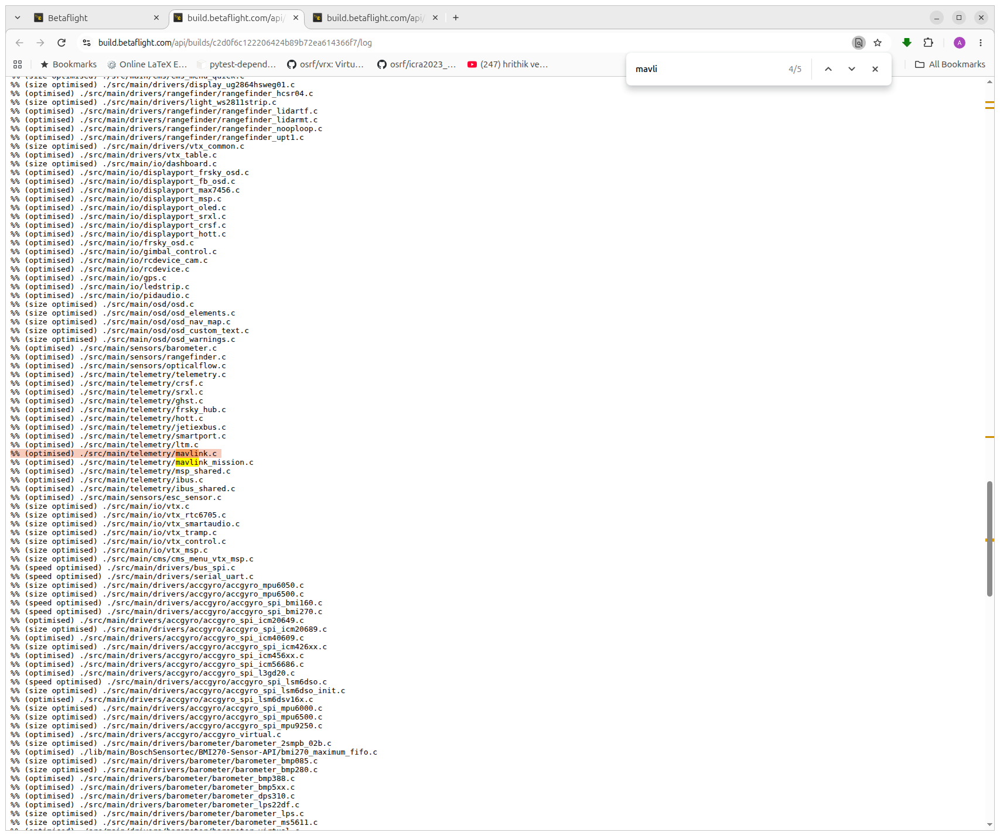
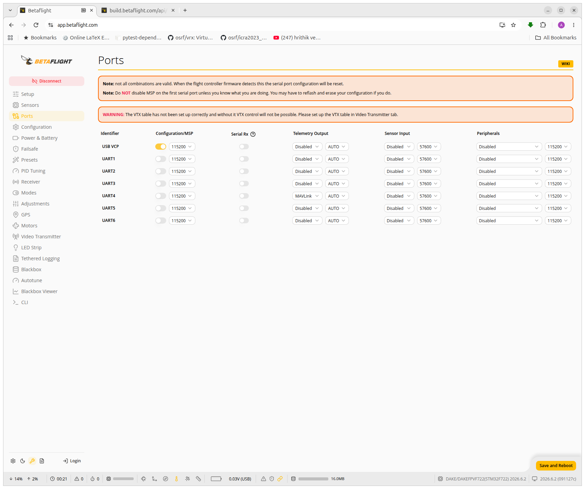
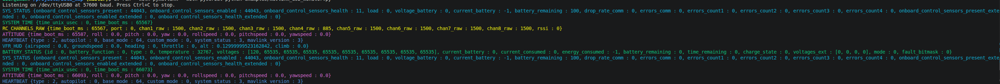

# Build Betaflight with MAVLink

Choose **SITL** for a simulated flight controller, or **hardware firmware** for a physical board.

## Contents

- [Build SITL locally](#build-sitl-locally)
- [Configure MAVLink on TCP port 5762](#configure-mavlink-on-tcp-port-5762)
- [Build and flash hardware firmware](#build-and-flash-hardware-firmware)
- [MAVLink code examples](#mavlink-code-examples)
- [Troubleshooting](#troubleshooting)

## Build SITL locally

This project uses the official Betaflight 2026.6.2 source. On Linux x86-64, install Git, Make and a C compiler, then run:

```bash
git clone --branch 2026.6.2 --depth 1 https://github.com/betaflight/betaflight.git
cd betaflight
git submodule update --init src/config
make TARGET=SITL EXTRA_FLAGS='-DUSE_TELEMETRY -DUSE_TELEMETRY_MAVLINK' -j4
```

The executable is `obj/main/betaflight_SITL.elf`. Both flags are needed for this SITL target. The project binary was built with these flags, without the sensor-only patch. SITL saves configuration in its working directory; run it from a dedicated directory to keep its EEPROM separate.

## Configure MAVLink on TCP port 5762

SITL maps its simulated UARTs to TCP ports: UART1 uses port 5761 and UART2 uses port 5762. Enabling MAVLink in the build makes the feature available, but UART2 does not listen until it is assigned to MAVLink telemetry.

The project configuration file [`config/sitl-mavlink.txt`](../config/sitl-mavlink.txt) contains:

```text
serial UART2 512 115200 57600 57600 115200
feature TELEMETRY
```

The `serial` line assigns UART2 the function mask `512` (MAVLink telemetry). The four numbers after it are, in order, the MSP, GPS, telemetry and peripheral baud-rate settings. The telemetry setting is 57600 baud; the TCP client does not set a physical baud rate. `feature TELEMETRY` enables telemetry in the saved configuration. This assignment replaces any previous UART2 function.

### Set up and run in VS Code

1. Stop any running SITL instance, then run **Tasks: Run Task → SITL: Configure MAVLink UART2**. This applies the file once and saves the settings in `.sitl/eeprom.bin`.
2. Run **SITL: Run and choose MAVLink example**, then select **Heartbeat** or **Attitude and VFR_HUD rates**. It starts SITL and runs the selected example against `tcp:127.0.0.1:5762`.
3. Look for a heartbeat or the measured message rates in the example's terminal. Stop the SITL task when finished.

You can also run the **SITL: Run** and **MAVLink: Read heartbeat** tasks separately, in that order. The configuration persists in `.sitl/eeprom.bin`, so repeat setup if that file is removed or the UART assignment changes.

### Set up and run in terminals

From the project root, with SITL stopped, apply the configuration:

```bash
mkdir -p .sitl
(cd .sitl && ../bin/betaflight_2026.6.2_SITL --config ../config/sitl-mavlink.txt)
```

Start SITL in the same working directory:

```bash
cd .sitl
../bin/betaflight_2026.6.2_SITL
```

Leave it running. In another terminal, from the project root, run:

```bash
uv run --with pymavlink python examples/mavlink_heartbeat.py tcp:127.0.0.1:5762
```

If the connection is refused, check that SITL is running with the `.sitl` working directory and that setup completed successfully. Confirm the port is listening with `ss -ltn | grep 5762`; inspect SITL's output for a UART2 bind error. If a connection succeeds but no heartbeat arrives, check that the included MAVLink-enabled binary and the saved UART2 configuration are being used. See [Betaflight serial configuration](https://betaflight.com/docs/wiki/guides/current/Serial).

## Build and flash hardware firmware

These steps use the Betaflight App with firmware 2026.6.2. Remove propellers and save a configuration backup and CLI `diff all` before flashing. A full chip erase removes saved settings. Do not restore a configuration from a different firmware version without checking compatibility.

1. Open **Firmware Flasher → Board & Build**. Select your exact board and version. For the FC in this project, the board is `FLYFISHRCF405`.
2. Select the radio protocol used by the receiver. For an ELRS serial receiver, keep **CRSF**. Review the other options needed by your aircraft.
3. If the telemetry selector is unavailable because telemetry is automatically included with CRSF, enable **Expert Mode** and enter `TELEMETRY_MAVLINK` in **Custom Defines**. This adds MAVLink alongside CRSF; it does not assign a UART.
4. Click **Load Firmware [Online]**. Open **Show Log** to check the build result and applied MAVLink define. Check the displayed build options and save the loaded `.hex` file if you want a local copy.
5. Enter DFU using the app's bootloader option, or the board's boot button while connecting USB. In DFU the board may not identify its target; select the correct board manually. On Linux, check for `0483:df11` with `lsusb` if DFU is not shown.
6. In **Flash**, select the loaded firmware and the DFU device, review erase options, then click **Flash Firmware**. After reboot, reconnect, restore or review settings as appropriate, and verify receiver and failsafe operation before flight.
7. In **Ports**, assign **MAVLink** under **Telemetry Output** on a free UART, choose AUTO or 57600, and **Save and Reboot**. Keep MSP enabled on USB VCP and leave the receiver UART assigned to Serial RX.

Connect FC UART TX to adapter RX and GND to GND for receive-only monitoring. To request message rates, also connect adapter TX to FC UART RX after confirming compatible logic levels. Do not connect adapter power to the FC without verifying the power arrangement. Shared MSP/telemetry ports can switch ownership; use a separate UART for simultaneous Configurator access and telemetry.


The screenshots below show the flasher workflow; appearance may vary by app version.

### Board and build options





### Enter DFU and flash







### Check the build log



### Configure the telemetry port



See the official [Firmware Flasher guide](https://betaflight.com/docs/wiki/app/firmware-flasher-tab), [build options](https://betaflight.com/docs/wiki/guides/current/Build-Options), and [USB flashing guide](https://betaflight.com/docs/wiki/guides/current/USB-Flashing).

## MAVLink code examples

```python title="monitor"
"""Print MAVLink messages and per-type receive rates from a serial adapter."""
import argparse
from collections import Counter
import sys
import time

from pymavlink import mavutil

parser = argparse.ArgumentParser(description=__doc__)
parser.add_argument('device', nargs='?', default='/dev/ttyUSB0', help='Serial device (default: /dev/ttyUSB0)')
parser.add_argument('--baud', type=int, default=57600, help='Serial baud rate (default: 57600)')
args = parser.parse_args()

connection = mavutil.mavlink_connection(args.device, baud=args.baud)
colors = ('\033[36m', '\033[32m', '\033[33m', '\033[35m', '\033[34m')
assigned = {}
counts = Counter()
started = time.monotonic()
try:
    print(f'Listening on {args.device} at {args.baud} baud. Press Ctrl+C to stop.', flush=True)
    while True:
        remaining = max(0, 1 - (time.monotonic() - started))
        message = connection.recv_match(blocking=True, timeout=remaining)
        if message is not None:
            name = message.get_type()
            counts[name] += 1
            if sys.stdout.isatty():
                color = assigned.setdefault(name, colors[len(assigned) % len(colors)])
                print(f'{color}{message}\033[0m', flush=True)
            else:
                print(message, flush=True)
        now = time.monotonic()
        elapsed = now - started
        if elapsed >= 1:
            rates = ', '.join(f'{name}: {count / elapsed:.1f} Hz' for name, count in sorted(counts.items()))
            print(f'Rates: {rates or "no messages"}', flush=True)
            counts.clear()
            started = now
except KeyboardInterrupt:
    pass
finally:
    connection.close()

```




---

### Measure MAVLink message rates

With a MAVLink-enabled serial adapter connected to the FC, request `ATTITUDE` and `VFR_HUD` at 50 Hz and print their received rates once per second for one minute. For SITL, replace `/dev/ttyUSB0` with `tcp:127.0.0.1:5762`:

```bash
uv run --with pymavlink --with pyserial python examples/mavlink_rates.py /dev/ttyUSB0
MAVLink connected: heartbeat from system 1, component 1
Requested ATTITUDE at 50 Hz
Requested VFR_HUD at 50 Hz
 1s: ATTITUDE 27.0 Hz, VFR_HUD 27.0 Hz
 2s: ATTITUDE 50.0 Hz, VFR_HUD 50.0 Hz
 3s: ATTITUDE 49.0 Hz, VFR_HUD 49.0 Hz
 4s: ATTITUDE 50.0 Hz, VFR_HUD 49.0 Hz
 5s: ATTITUDE 48.0 Hz, VFR_HUD 49.0 Hz
 6s: ATTITUDE 50.0 Hz, VFR_HUD 50.0 Hz
 7s: ATTITUDE 50.0 Hz, VFR_HUD 50.0 Hz
```


```python title="mavlink_rates.py"
"""Request ATTITUDE and VFR_HUD at 50 Hz and measure reception for 60 seconds."""

import argparse
import time

from pymavlink import mavutil

DEFAULT_BAUD = 57600
HEARTBEAT_TIMEOUT_S = 10
ACK_TIMEOUT_S = 5
REQUESTED_RATE_HZ = 50
MICROSECONDS_PER_SECOND = 1_000_000
MESSAGE_INTERVAL_US = MICROSECONDS_PER_SECOND // REQUESTED_RATE_HZ
DURATION_S = 60

parser = argparse.ArgumentParser(description=__doc__)
parser.add_argument("endpoint", help="TCP endpoint or serial device, e.g. /dev/ttyUSB0")
parser.add_argument("--baud", type=int, default=DEFAULT_BAUD, help=f"Serial baud rate (default: {DEFAULT_BAUD})")
args = parser.parse_args()
connection = mavutil.mavlink_connection(args.endpoint, baud=args.baud)

try:
    heartbeat = connection.wait_heartbeat(timeout=HEARTBEAT_TIMEOUT_S)
    if heartbeat is None:
        raise SystemExit(f"No heartbeat received within {HEARTBEAT_TIMEOUT_S} seconds")
    print(f"MAVLink connected: heartbeat from system {heartbeat.get_srcSystem()}, "
          f"component {heartbeat.get_srcComponent()}", flush=True)

    for name, message_id in (("ATTITUDE", mavutil.mavlink.MAVLINK_MSG_ID_ATTITUDE),
                             ("VFR_HUD", mavutil.mavlink.MAVLINK_MSG_ID_VFR_HUD)):
        connection.mav.command_long_send(
            connection.target_system, connection.target_component,
            mavutil.mavlink.MAV_CMD_SET_MESSAGE_INTERVAL, 0,
            message_id, MESSAGE_INTERVAL_US, 0, 0, 0, 0, 0,
        )
        deadline = time.monotonic() + ACK_TIMEOUT_S
        while True:
            remaining = deadline - time.monotonic()
            if remaining <= 0:
                raise SystemExit(f"No interval acknowledgement for {name}")
            ack = connection.recv_match(type="COMMAND_ACK", blocking=True, timeout=remaining)
            if ack is None:
                raise SystemExit(f"No interval acknowledgement for {name}")
            if ack.command == mavutil.mavlink.MAV_CMD_SET_MESSAGE_INTERVAL:
                if ack.result != mavutil.mavlink.MAV_RESULT_ACCEPTED:
                    raise SystemExit(f"Interval request for {name} rejected: result {ack.result}")
                print(f"Requested {name} at {REQUESTED_RATE_HZ} Hz")
                break

    counts = {"ATTITUDE": 0, "VFR_HUD": 0}
    start = time.monotonic()
    last = start
    for second in range(1, DURATION_S + 1):
        deadline = start + second
        while (remaining := deadline - time.monotonic()) > 0:
            message = connection.recv_match(type=list(counts), blocking=True, timeout=remaining)
            if message is not None:
                counts[message.get_type()] += 1
        now = time.monotonic()
        elapsed = now - last
        print(f"{second:2d}s: ATTITUDE {counts['ATTITUDE'] / elapsed:.1f} Hz, "
              f"VFR_HUD {counts['VFR_HUD'] / elapsed:.1f} Hz", flush=True)
        counts = dict.fromkeys(counts, 0)
        last = now
finally:
    connection.close()

```

## Troubleshooting

- **MAVLink missing:** confirm the build includes `TELEMETRY_MAVLINK` and the telemetry feature is enabled. CRSF telemetry being automatic does not by itself prove MAVLink is included.
- **DFU not visible:** try a data-capable cable and direct USB connection; check Linux DFU permissions and the app's device selection.
- **No heartbeat:** check FC power, UART assignment, TX-to-RX wiring, common ground, baud rate and port sharing.
- **No command acknowledgement:** a heartbeat only proves FC-to-adapter data. Check the adapter TX to FC RX connection and compatible logic voltage; receive-only wiring cannot send rate requests.
