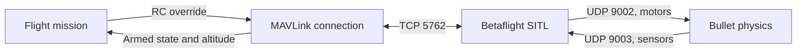
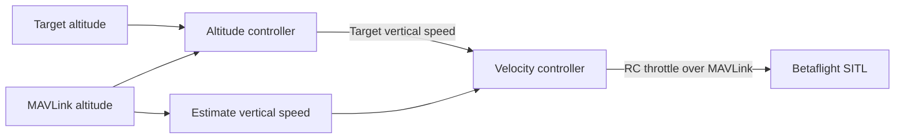

# MAVLink flight experiment

> **Not working:** This example does not currently run. MAVLink RC commands and the required Betaflight SITL receiver support and configuration need further investigation.

This standalone simulation experiment sends RC overrides and reads telemetry over MAVLink. It copies the altitude controller and Bullet physics setup into this folder. It is not for hardware flight.



## Control chain



## Setup

The bundled `bin/betaflight_2026.6.2_SITL` rejects `serialrx_provider = MAVLINK`, so this example cannot run with that binary. A Betaflight SITL build with MAVLink receiver support and the Bullet sensor-only patch is required; its receiver and telemetry configuration must be verified before use.

With a compatible build installed at that path, run the **Bullet: SITL MAVLink flight** VS Code task. It configures and starts SITL along with the example. Alternatively, run:

```sh
uv run --project /home/user/workspaces/bullet --locked --all-packages --all-extras --all-groups python examples/mavlink_flight/main.py
```

The example also requires `pymavlink` in the Bullet environment. The mission and its configuration have not been validated end to end.

Telemetry uses shared `Heartbeat`, `Attitude`, and `VfrHud` payload entities. Read altitude from `snapshot().vfr_hud.alt` and freshness from `vfr_hud_at`. Both RC send paths construct the shared `RcChannels` entity before protocol encoding.
