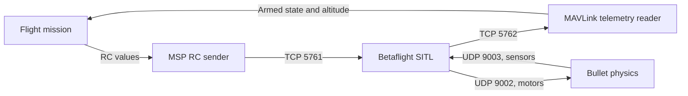
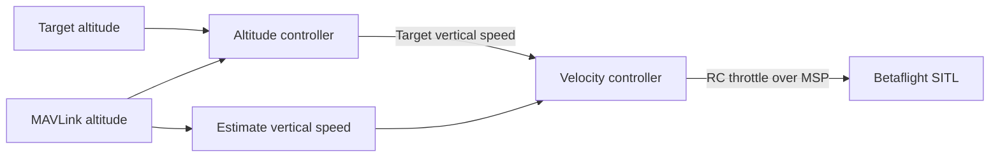

# Bullet flight integration: investigation

This example uses an experimental cascaded altitude controller in simulation. The intended architecture uses Bullet physics, Betaflight SITL, MSP RC commands and MAVLink-only telemetry. Do not use it for hardware flight.

Bullet's existing Betaflight backend expects its sensor-only firmware patch. A 2026.6.2 build using that patch and `-DSITL_SENSOR_ONLY -DUSE_TELEMETRY -DUSE_TELEMETRY_MAVLINK` compiles and contains MAVLink symbols, but physics exchange, MAVLink telemetry, arming and flight are not yet verified. The included project binary is unpatched.

The Bullet profile uses `feature RX_MSP`, AETR channel order, AUX1 for arming and AUX2 for angle mode. MAVLink telemetry must also be assigned to UART2. Arming, altitude estimates, control gains and failsafe behavior require simulation testing before an automated takeoff can be implemented safely.

Run the **Bullet: SITL MSP MAVLink flight** VS Code task with the local Bullet workspace installed. The cascaded controller was tested in a simulated takeoff, hover, landing and disarm. The task is simulation-only and uses an experimental controller; do not use it on hardware.

## Control chain

The controller estimates vertical speed from new MAVLink altitude samples. The inner PI loop adjusts throttle within simulation-only limits. Hover requires altitude within 0.5 m for 10 seconds. The tuning is specific to this simulation.

## MAVLink message rates

| Message | Purpose | Requested rate |
| --- | --- | --- |
| `VFR_HUD` | Altitude | 50 Hz |
| `ATTITUDE` | Roll, pitch and yaw | 50 Hz |
| `HEARTBEAT` | Armed state | Firmware default |

`MAV_CMD_SET_MESSAGE_INTERVAL` requests the first two rates. The log reports actual received rates each second; delivery can be slower. Attitude angles are in radians.
