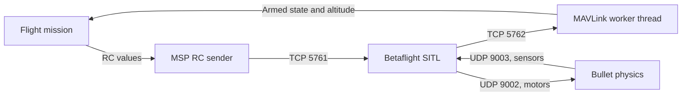
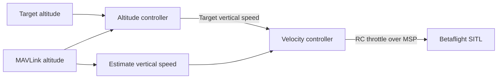
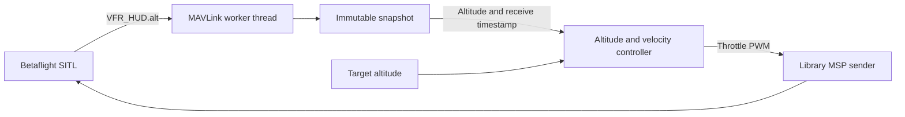

# Bullet flight integration: investigation

This example uses an experimental cascaded altitude controller in simulation. The intended architecture uses Bullet physics, Betaflight SITL, MSP RC commands and MAVLink-only telemetry. Do not use it for hardware flight.



Bullet's existing Betaflight backend expects its sensor-only firmware patch. A 2026.6.2 build using that patch and `-DSITL_SENSOR_ONLY -DUSE_TELEMETRY -DUSE_TELEMETRY_MAVLINK` compiles and contains MAVLink symbols, but physics exchange, MAVLink telemetry, arming and flight are not yet verified. The included project binary is unpatched.

The Bullet profile uses `feature RX_MSP`, AETR channel order, AUX1 for arming and AUX2 for angle mode. MAVLink telemetry must also be assigned to UART2. Arming, altitude estimates, control gains and failsafe behavior require simulation testing before an automated takeoff can be implemented safely.

Run the **Bullet: SITL MSP MAVLink flight** VS Code task with the local Bullet workspace installed. The cascaded controller was tested in a simulated takeoff, hover, landing and disarm. The task is simulation-only and uses an experimental controller; do not use it on hardware.

## Control chain



The controller estimates vertical speed from new MAVLink altitude samples. The inner PI loop adjusts throttle within simulation-only limits. Hover requires altitude within 0.5 m for 10 seconds. The tuning is specific to this simulation.

## MAVLink message rates

| Message | Purpose | Requested rate |
| --- | --- | --- |
| `VFR_HUD` | Altitude | 50 Hz |
| `ATTITUDE` | Roll, pitch and yaw | 50 Hz |
| `HEARTBEAT` | Armed state | Firmware default |

`MAV_CMD_SET_MESSAGE_INTERVAL` requests the first two rates. The log reports actual received rates each second; delivery can be slower. Attitude angles are in radians.

## Running with the client library

The RC sender uses `beta_client.msp.send_rc` and `TcpTransport`. PWM values are named in `pwm.py`; their values and channel mapping match the existing simulation profile.

From the repository root, run:

```sh
uv run --extra flight --locked python examples/msp_mavlink_flight/main.py
```

The `flight` extra installs the local `bullet_drone` project configured in `pyproject.toml`. The VS Code task uses the same environment. TCP uses the library defaults: a 20 ms write timeout and a 3-second connection timeout.

## Threaded telemetry and altitude control

The library's `MavlinkTelemetry` owns a pymavlink connection on a worker thread. Startup waits only for a vehicle heartbeat. The mission then calls `set_message_rate` for `VFR_HUD` and `ATTITUDE` at its named `TELEMETRY_RATE_HZ` of 50 Hz. Each call waits synchronously for acceptance and raises on rejection or missing acknowledgement. The worker keeps telemetry received while waiting for acknowledgements, filters messages to the selected vehicle component, and publishes immutable snapshots.



The mission reads one snapshot per loop, updates the controller only when the altitude timestamp changes, and keeps the previous throttle between samples. The controller estimates vertical speed from successive altitude samples instead of using `VFR_HUD.climb`. It uses altitude directly, without subtracting the starting altitude. Timestamps are local monotonic reception times, not sensor acquisition times.

The mission checks finite altitude and stale telemetry. Worker errors surface on the next snapshot read and trigger mission cleanup. Requested rates can differ from the measured rates published in snapshots. Closing telemetry stops and joins the worker, which releases the connection. This does not replace end-to-end firmware and flight validation.

## Simulation constants

Mission timing and flight tolerances are named in `main.py`, with unit suffixes for seconds, metres and metres per second. Controller gains, speed limits and sample-gap handling are in `altitude_control.py`; PWM calibration remains in `pwm.py`. Physics timing, mass, gravity and fallback controller settings are in `physics.py`. These values retain the existing simulation tuning and are not hardware calibration.
